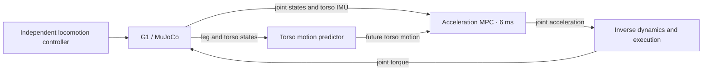

# Control architecture

The system stabilizes five right-arm joints while an independent controller handles locomotion. The left arm uses fixed-joint-angle PD as a reference. Torso motion enters the arm task models as a measured or predicted input; the MPC does not optimize leg motion or ground contact forces.

## MPC update

The state is `x = [q; dq]` and the input is `u = ddq`. Nine intervals of 6 ms give ten state nodes. At each update the controller:

1. Reads the current joints and torso motion.
2. Obtains future torso orientation, linear acceleration, angular velocity, and angular acceleration.
3. Builds local end-effector task models along a reference trajectory.
4. Forms a quadratic objective and linear constraints, solves the QP, and applies the first planned acceleration.

The objective balances upright alignment, end-effector motion, joint centering, and smooth joint motion. The hardware QP also includes model-based torque bounds. See the [MPC equations](docs/design/MPC_DESIGN.md).

## Simulation

`main_sim.py` owns the MuJoCo state. Physics advances every 2 ms; the lower-body Torch policy updates every 20 ms. Python assembles the MPC, while C++ components perform inverse dynamics and torque execution.

The comparison task requests forward motion for **10 s**, then records **3 s after the stop request**. A torso-motion template is built from repeated executions of this task. The MPC baseline without future preview instead extrapolates torso orientation using current angular velocity and holds the other torso-motion inputs constant.

Simulation starts from an inverse-dynamics torque and uses a local torque-to-acceleration Jacobian with forward-dynamics checks to reduce acceleration tracking error. MuJoCo therefore participates in execution correction as well as physical simulation.

| Component | Main files |
| --- | --- |
| MPC objective and constraints | [arm_mpc.py](arm_mpc.py) |
| Torso-motion prediction | [disturbance_predictor.py](disturbance_predictor.py), [disturbance_template/](disturbance_template/) |
| Task kinematics | [kinematics_helper.py](kinematics_helper.py), [robot_model_backend/](robot_model_backend/) |
| Native inverse dynamics and execution | [cpp/](cpp/) |
| Matched comparison and replay | [tools/experiments/thesis_walk13/](tools/experiments/thesis_walk13/) |

## Hardware

The Unitree G1 EDU provides torso IMU and joint feedback. Its existing locomotion program controls the lower body. The arm controller publishes through the Arm SDK interface, using a separate hardware implementation of the acceleration MPC.

The hardware torso-motion predictor matches current leg and torso states to recorded past walks and uses their subsequent torso motion as a forecast. It uses a frozen data bank; it does not train online.

The execution model is a coupled five-joint arm model with measured moving-base inputs:

$$\tau = M(q)u + b.$$

Here `b` includes gravity, velocity effects, and the modeled influence of torso motion. Hardware does not run the simulation's whole-model forward-dynamics correction. Computed torque is passed through command construction and execution limits before transmission.

| Component | Main files in `tools/g1_commissioning/` |
| --- | --- |
| MPC task models and solver | `hardware_mpc_control.py`, `hardware_mpc_solver.py` |
| Recorded-walk torso-motion predictor | `hardware_mpc_predictor.py` |
| Moving-base arm inverse dynamics | `hardware_arm_inverse_dynamics.py` |
| Torque and command construction | `hardware_mpc_torque_control.py`, `hardware_mpc_learned.py` |
| Generic runtime and computation process | `g1_walk_mpc.py`, `mpc_compute_process.py` |
| Position PID comparison | `hardware_pid_control.py`, `hardware_position_pid_zero.py` |

## Interpreting the comparison

Simulation and hardware use different locomotion controllers, torso-motion prediction data, and torque execution paths. Hardware end-effector metrics are reconstructed from joint and IMU feedback. Improved direction control does not imply that every acceleration metric improves, and model-based constraints do not guarantee identical physical acceleration or contact-free motion.
