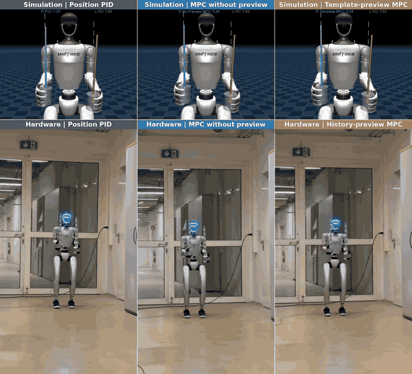

# G1 Arm Stabilization with MPC

Model predictive control for keeping a Unitree G1 arm upright during locomotion while limiting end-effector motion. The arm controller works alongside the existing locomotion controller and uses torso IMU feedback, joint states, and predicted torso motion.

[](media/simulation_hardware_comparison.mp4)

**Click the six-second preview to open the full 13-second video.** Top: MuJoCo simulation. Bottom: hardware experiments. Columns, from left to right: position PID, MPC without future preview, and MPC with torso-motion preview. Gray guides in simulation show the world vertical. Every left arm uses fixed-joint-angle PD as a reference; the right arm uses the method named above its column. The physical tubes help visualize direction; they are not precision alignment references.

## What the controller does

- Controls five right-arm joints without replacing the existing lower-body locomotion controller.
- Optimizes joint accelerations every **6 ms**, over **nine prediction intervals**.
- Balances upright alignment, end-effector linear/angular acceleration, angular velocity, and smooth joint motion in a quadratic program.
- Enforces joint position, velocity, and acceleration limits; the hardware formulation also includes model-based torque limits.
- Converts planned acceleration into joint torque using a coupled arm model that includes measured torso motion.

```text
G1 joint states and torso IMU ────────────────┐
                 │                          │
                 ▼                          ▼
       Torso motion predictor ───────► Acceleration MPC
                                            │
                                     joint acceleration
                                            ▼
                                   Inverse dynamics
                                            │
                                        joint torque
                                            ▼
                                      G1 right arm
```

Simulation preview uses a torso-motion template averaged from repeated executions of the same task. Hardware preview matches current leg and torso states to recorded past walks and uses the subsequent recorded torso motion as a prediction. The MPC baseline without future preview still uses current IMU feedback: it extrapolates orientation from current angular velocity and holds the other torso-motion inputs constant.

Simulation additionally corrects the initial inverse-dynamics torque using local forward-dynamics checks. Hardware sends the torque computed from its moving-base arm model, `τ = M(q)q̈ + b`. These execution paths and the lower-body controllers differ between simulation and hardware.

## Measured results

Each result below is from one complete **10 s forward walk + 3 s after the stop request**. Smaller values are better. Swing RMS measures changes in the hand direction about its own mean axis, separately from persistent tilt.

| Right-arm method | Simulation mean tilt (°) | Simulation swing RMS (°) | Hardware mean tilt (°) | Hardware swing RMS (°) |
| --- | ---: | ---: | ---: | ---: |
| Position PID | 0.630 | 0.701 | 2.572 | 3.368 |
| MPC without future preview | 0.229 | 0.258 | 0.638 | 0.571 |
| MPC with torso-motion preview | **0.154** | **0.175** | **0.619** | **0.565** |

Preview reduced simulation swing RMS by **32.2%** relative to MPC without future preview. On hardware, the two MPC settings had similar orientation performance; history preview reduced angular acceleration RMS from **6.365 to 5.343 rad/s²**. Hardware linear acceleration remained higher with history-preview MPC (**2.015 m/s²**) than with position PID (**1.940 m/s²**), so orientation improvement does not imply improvement in every motion metric.

Hardware metrics are reconstructed from joint and IMU feedback. Comparisons are made within simulation or hardware, rather than treating their numerical values as directly equivalent. Full simulation metrics and execution-check status are in the [simulation results](docs/simulation/experiments/20261117_walk10_stop3/README.md).

## Try the saved simulation

From the repository root, install the replay dependencies and open a saved trajectory:

```bash
python -m pip install numpy==2.2.6 mujoco==3.6.0 glfw==2.10.0 PyYAML==6.0.3
python tools/experiments/thesis_walk13/replay.py D03 --check
python tools/experiments/thesis_walk13/replay.py D03
```

Use `D01` for position PID or `D02` for MPC without future preview. Replays render recorded physical states and do not connect to a robot or rerun the controller. Graphical replay needs a desktop with OpenGL; `--check` runs without a display.

## Explore the implementation

| Topic | Entry point |
| --- | --- |
| Installation and numerical simulation | [Quick start](docs/QUICKSTART.md) |
| MPC and task models | [MPC design](docs/design/MPC_DESIGN.md), [arm_mpc.py](arm_mpc.py) |
| Simulation torso-motion prediction | [disturbance_predictor.py](disturbance_predictor.py) |
| Hardware MPC | [hardware_mpc_control.py](tools/g1_commissioning/hardware_mpc_control.py), [hardware_mpc_solver.py](tools/g1_commissioning/hardware_mpc_solver.py) |
| Hardware torso-motion prediction | [hardware_mpc_predictor.py](tools/g1_commissioning/hardware_mpc_predictor.py) |
| Hardware inverse dynamics | [hardware_arm_inverse_dynamics.py](tools/g1_commissioning/hardware_arm_inverse_dynamics.py) |
| Native execution components | [cpp/](cpp/) |

**Stack:** Python, C++, NumPy, MuJoCo, Pinocchio, DAQP, and the Unitree SDK for hardware integration.
